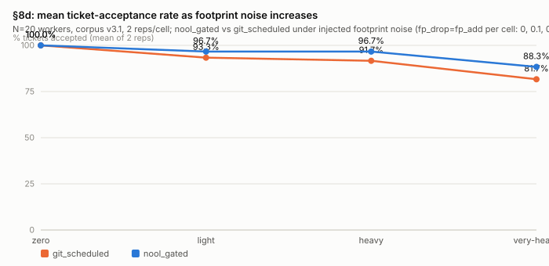

# Nool Benchmark Suite

This repository compares [Nool](https://nool.dev) with Git using local
mechanism tests, synthetic agent-fleet studies and coding-agent pilots. The
current Track C adapters are Claude Code, OpenCode and Codex. These tracks
measure different things; read their results separately.

**Design spec / pre-registration:**
`docs/superpowers/specs/2026-08-20-nool-benchmark-suite-design.md` —
hypotheses H1–H7 and the analysis plan were committed before any Tier 1 data
was collected. Read it before the numbers.

**Enterprise build-versus-buy evaluation:**
[CLI-grounded coverage review and runnable profile](docs/enterprise-benchmarks.md)
adds source-size/navigation, trusted CI evidence, audit replay/tampering,
independent approval/resume and lease-pressure probes, plus a matched-run ownership
cost calculator. Start with `make -f enterprise/Makefile smoke`; the full profile
is opt-in. Synthetic probes are kept separate from agent/fleet evidence.

**Results across the suite:** [current results and limits](docs/findings/2026-11-01-benchmark-results.md)
summarizes Tracks B, C, D and G plus the November enterprise probes. It links
to the detailed reports and raw artifacts; the tracks are not combined into a
single score.

## In plain terms

The results do not point to one universal winner. Deterministic mechanism
tests show Nool can prevent some merge and attribution failures, while its
landing path costs more time than a comparable Git hook. In the fleet tests,
a Git scheduler matches Nool when file plans are accurate; Nool's lead under
noisy plans is small and still based on few repetitions. The November Codex
pilot passed all four cells once, which is a useful harness check, not evidence
of a product advantage.

The latest enterprise smoke run passed 35 of 36 checks. The failed check is
an imported-history integrity failure and remains in the report. The
[results overview](docs/findings/2026-11-01-benchmark-results.md) gives the
outcomes and limitations for each track and links to the underlying reports.

## Why this suite, not an existing benchmark

Several published benchmarks already grade coding-agent output — the
obvious question is why not just run one of those. None of them put the
**VCS/coordination layer itself** on trial: they vary the model or the
task while the repo is written to by one agent at a time (or, in
CooperBench's case, a fixed N=2 with the coordination mechanism held
constant). This suite fixes the tasks and the agent count and varies
**git vs nool** as the treatment, scaled up across a concurrency ladder —
the one axis none of the below can speak to.

| Benchmark | Agents | Unit under test | Concurrent writers to one repo | Independent variable | Scale |
|---|---|---|---|---|---|
| SWE-bench (+ Verified / Lite) | 1 | GitHub issue → patch | No | model/agent | 2,294 tasks, 12 Python repos |
| SlopCodeBench | 1 | agent re-extends its own prior solution across checkpoints | No | model/agent, long-horizon only | 20 problems × 93 checkpoints |
| SWE-EVO | 1 | multi-file feature evolution from real release notes | No | model/agent | 48 tasks, 7 repos, avg 21 files/task |
| CooperBench | 2 (fixed) | two features landed on one shared repo concurrently | Yes — real merge-conflict risk | task difficulty / model; coordination mechanism (git + Redis messaging) held fixed | ~600 tasks, 12 repos, 4 languages (arXiv:2601.13295) |
| **nool_benchmarks (this suite)** | N=10–50 (concurrency ladder) | ticket-level changes dispatched across a shared corpus | Yes — merge conflicts / build-poisoning / attribution ARE the metrics | **VCS/coordination substrate: git vs nool**; tasks and agent count held fixed | 60-ticket corpus v3; N=25 and N=35 measured to date, N=50 pre-registered but deprioritized in favor of the mechanism question (see below) |

CooperBench is the closest existing analog — the only one of the four with
real concurrent-writer risk — which is why it's already planned as a Tier 2
adaptation (Track A1, spec [§5](docs/superpowers/specs/2026-08-20-nool-benchmark-suite-design.md#sec-5)) rather than something this suite ignores.
The relationship is an inversion, not a duplication: CooperBench fixes the
coordination mechanism and varies task difficulty at N=2; this suite fixes
the tasks and varies the coordination mechanism at fleet scale. SlopCodeBench
(Track A2) and SWE-EVO (Track A3) are single-agent and contribute nothing on
the concurrency axis, but are still adapted for their own axes (long-horizon
degradation, multi-file evolution) rather than duplicated by Track D.

*Note on the CooperBench figure above:* the paper (arXiv:2601.13295) reports
~600 tasks across 12 repos / 4 languages; a public adapter repository for the
same benchmark lists smaller subset counts (199 features / 30 tasks / 652
feature pairs). The paper figure is cited as canonical here — confirm
directly against the benchmark's own source before the Track A1 integration
relies on either number.

## Findings at a glance (runs 1–3, fleet scale-up 1 and 2, nool 7.0.0/7.0.1, footprint-source robustness §8d; 2026-08-20/27)

Full report with figures and provenance:
[`docs/findings/2026-08-21-findings.md`](docs/findings/2026-08-21-findings.md) ·
academic write-up: `docs/paper/2026-08-nool-fleet-study.md`. One pinned
model (claude-sonnet-5) throughout; product versions 6.13.0 → 6.14.1 →
7.0.0 → 7.0.1 recorded per run. Acceptance rate (% of tickets landed and
passing their own test) is the headline number in every point below,
with raw counts alongside for anyone checking the underlying data —
rates are what carry over to a differently-sized corpus, counts don't.


1. **Having agents check in with each other before they start work
   prevents pile-ups.** Across a range of fleet sizes (N=25 and N=35
   agents working at once) on a 60-ticket workload: the coordinated
   setup landed **100%** of tickets with zero conflicts, every time (4
   of 4 runs). Plain, uncoordinated git lost roughly a third of tickets
   to conflicts at every size (**62–68%** landed across the 4 runs), and
   at the largest size (N=35) one of those two runs suffered a much
   worse failure on top of the usual conflicts: its tickets still built
   and looked fine individually, but a single bad merge silently broke
   shared behavior and voided everything downstream of it, dragging
   that run down to **33%** landed (20/60). Cost per
   landed ticket was also lower for the coordinated setup throughout
   ($0.11–0.21 vs $0.18–3.80 for git).
2. **A well-built git scheduler can match Nool — when its information
   is accurate.** An audit found that the win in (1) came from the
   *idea* of checking in before starting work, not specifically from
   Nool as a tool — a git-only scheduler running the identical
   check-in logic (`git_scheduled`) matched Nool's own real
   coordination arm (`nool_gated`) at every fleet size tested: both hit
   **100%** landed with zero conflicts whenever agents' stated plans
   were accurate. Nool's edge, if any, has to come from something
   other than the coordination idea itself — which is exactly what (4)
   below tests.
3. **Catching problems only after work is already done wastes real
   money.** A setup that lets every agent start immediately and only
   checks for trouble at merge time throws away a meaningful share of
   what it spent — **37–41%** of one scale-up's total spend
   ($1.40–1.57 out of every ~$3.80 run) paid for work that never made
   it in. Adding a stricter check *after* merging (a CI gate) catches
   the silent-breakage failure mode from (1) but doesn't fix the
   waste, since agents already started blind — it inherited the same
   ~33% conflict rate and lost a similar **~38–40%** of its spend
   per run to work that never landed. Checking in *before* starting
   work (whether via Nool or a matching git scheduler) keeps wasted
   spend near $0 by refusing the conflicting ticket up front.
4. **When agents' stated plans are unreliable, Nool holds up better
   than git — and the advantage grows the worse the plans get.** This
   is the newest and most direct test of "why Nool instead of just a
   good scheduler" (2026-08-27, findings [§6d](docs/findings/2026-08-21-findings.md#sec-6d)–[§6h](docs/findings/2026-08-21-findings.md#sec-6h)): the same two
   check-in-based setups from (2), `nool_gated` and `git_scheduled`,
   run again — but this time roughly one file in ten (light), one in
   three (heavy), or one in two (very-heavy) is wrongly listed in each
   ticket's stated plan, either omitted or made up. Both start at
   **100%** landed with accurate plans; both slip as plans get worse,
   but git slips further at every step:

   | Plan accuracy | Nool | Git scheduler | Gap |
   |---|---|---|---|
   | Perfect | 100.0% | 100.0% | 0 pts |
   | Light noise | 96.7% | 93.3% | 3.3 pts |
   | Heavy noise | 96.7% | 91.7% | 5.0 pts |
   | Very heavy noise | 88.3% | 81.7% | **6.7 pts** |

   

   The gap only ever widened, never narrowed or reversed, at every
   level tested — exactly what was predicted in writing before this
   data was collected. This is still an early result: only 2 repeated
   runs per condition so far, and the likely mechanism (Nool catching
   a real problem at merge time that a plan-based scheduler missed) is
   the leading explanation, not something directly witnessed happening.
5. **"It passed" isn't the same as "it works."** The same known trouble
   spot from (1) — six tickets that all touch one shared billing file
   and are designed to look fine individually while conflicting in
   behavior — showed up again in one run: **100%** of tickets passed
   their own individual tests, while the shared codebase's overall test
   suite was silently broken the whole time. This wasn't caused by
   anything in test (4) above (it happened with zero noise injected) —
   it's a standing reminder that this suite always checks "did the
   whole system end up healthy," not just "did each individual ticket
   pass," because those two numbers can disagree.
6. **Nool's smaller, isolated mechanism tests show real wins in some
   areas and real costs in others.** Tracking who-changed-what stays
   accurate under heavy concurrent editing (plain git misattributes
   **57–64%** of operations at 15 simultaneous writers across the last
   two runs; Nool: **0%**, with no retries and nothing lost).
   Looking up relevant code context uses far less data (245–497 bytes
   vs. 660 for a plain search-and-read). Recovering from a bad change
   without losing later good work succeeded in every recent test
   (**100%**, was **0%** on older versions); merges among many
   contended branches also now converge cleanly every time (**100%**,
   was **7%** = git-equivalent, on older versions). Regression
   localization (bisect), a known open issue on earlier versions, has
   held since 7.1.4: on 7.19.0 it named the culprit knot in `1793 ms`
   against git bisect's `2668 ms`, in zero bisect steps. The costs:
   landing a change through Nool takes roughly **6–10x** longer than a
   git commit running a comparable pre-commit stack — `266–409 ms`
   fast-mode for 1–10 files vs `41–42 ms` hooked git (`23–24 ms` bare)
   — rising to about **40x** for a 100-file change (`1850 ms` vs
   `47 ms`), and **10–14x** (1–10 files) to **54x** (100 files) in full
   mode against a `go vet` baseline. Each agent hook adds `10.6–20.2 ms`
   per call. Measured on nool 7.19.0 (2026-10-12) on an idle machine
   (`quiet: true`); the 7.8.0 run of 2026-09-16 produced the same
   correctness, precision and recall values cell for cell, with timings
   within 5–15% in both the nool and the git arms except two cells (hook
   latency +3.3 ms on every hook, B2's 15-writer op median +33%) that
   are open as Nool task `c0cf9bb3` — see
   `docs/findings/2026-10-12-trackb-7.19.0-rerun.md`. At a few hundred
   milliseconds absolute this is dominated by the model call that
   precedes any agent commit. This study found and reported several real product bugs along
   the way (most already fixed by the vendor).

   *Baseline fairness (2026-09-05).* A bare `git add && git commit` does
   almost no work, while `nool propose --solidify` parses syntax, registers
   entities, evaluates blast radius and runs the policy gate — so quoting a
   ratio against bare git overstates Nool's overhead. `b1` now also runs
   **hooked git** arms: `git_precommit_fast` (a pre-commit hook doing a
   `gofmt` syntax precheck plus a forbidden-path / change-width policy gate,
   mirroring Nool's fast path) and `git_precommit_full` (adds `go vet`,
   standing in for reification). Against that baseline the fast-mode ratio
   falls to roughly **6–10x** for 1–10 files rather than the 11–17x a
   bare-git comparison implies, because a realistic enterprise pre-commit
   stack already costs about 2x a bare commit (at 100 files both
   comparisons are large — about 40x hooked, 71x bare — because the hooked
   stack stays near `47 ms` while Nool's landing grows with the files it
   parses). Two
   honest limits: neither git arm signs (no GPG key is assumed), so both
   still do strictly less than Nool and the ratios remain an upper bound;
   and `go vet` on a tiny synthetic repo is far cheaper than real
   reification, so `git_precommit_full` understates a genuine full-mode
   baseline. The hooked arms were first collected on a loaded machine
   (`quiet: false`, 7.1.4) and have since been re-run on an idle machine
   twice — 7.8.0 on 2026-09-16 and 7.19.0 on 2026-10-12, both
   `quiet: true` — and the ratios in finding 6 are from the 7.19.0 run.

   *Measurement correction (2026-09-05).* An earlier revision of `b1`
   quoted 7–10x from a cell that did not measure what its name claimed.
   `nool_land()` defaults to `fast=False` and the caller never passed
   `fast=True`, so the field recorded as `nool_propose_fast_solidify` was
   timing **full** mode. Separately, `--auto-justify` was gated on
   `n_files >= 100` on the assumption that the blast-radius gate trips
   near 100 nodes; 10 Go files in fact produce 16 nodes and trip the
   "Ask" band at 15, so all 10 reps of the 10-file cell exited 2 and the
   recorded 28.53 ms was the latency of a **refused** propose, not a
   landing. `b1` now runs both modes explicitly, applies `--auto-justify`
   to every cell (a no-op below the band), and records
   `nool_full_nonzero_exits` alongside the fast count; `summarize.py`
   renders both ratios so this figure cannot drift unnoticed again.
7. **Without any deliberate contention, nothing separates the two.**
   Run agents on a workload with no designed overlap at all and Nool
   and git perform identically on every metric measured, every time —
   an honest null, not a hidden win.

## Layout

| Path | What |
|---|---|
| `micro/` | Track B — deterministic mechanism micro-benchmarks (no LLM, no API keys, free to run) |
| `results/micro/` | Raw JSON output of Track B, committed with full provenance |
| `harness/` | Track C — LLM-in-the-loop 2×2 experiment harness; Track D fleet runner (`fleet_run.py`) |
| `tasks/` | Track C/D task catalogs (spec + starter + hidden held-out tests; fleet ticket corpora) |
| `results/trackc/` | Raw LLM-run records: 2×2 grid (`runs.jsonl`) and fleet runs (`fleet_runs.jsonl`) |
| `results/trackc/transcripts_manifest.jsonl` | SHA-256 manifest of every raw transcript (transcripts themselves are gitignored; verify with `make check-transcripts`) |
| `results/replications/` | Per-version Track B snapshots + `MANIFEST.md` indexing every run's conditions |
| `analysis/summarize.py` | Renders all committed results as tables, incl. run-level cross-rep inference (exact permutation Mann-Whitney per corpus/N/model cell, underpowered cells labeled). Numbers only — no conclusions in code |
| `analysis/make_figures.py` | Regenerates every figure in `docs/findings/` from the raw JSON |
| `Makefile` / `Dockerfile` | One-command replication (`make trackB`, `tier1`, `trackC`) and containerized execution ([§8](docs/superpowers/specs/2026-08-20-nool-benchmark-suite-design.md#sec-8)) |
| `docs/findings/` | Findings report with figures; `docs/paper/` holds the academic write-up |
| `docs/findings/2026-11-01-benchmark-results.md` | Current cross-track results guide, with limits and links to raw evidence |

Pre-suite pilot material (manual runs, no provenance — **not evidence**) was
archived and then removed from the working tree; it remains recoverable from
Knot DAG history (the `archive/` knots of 2026-08-20, including
`ARCHIVE.md`, which inventories it and explains why each item is excluded).

## Running Track B (anyone can, free)

Requirements: macOS/Linux, Python 3.11+, git, and the `nool` CLI on PATH
(version is recorded in each result's provenance block).

```bash
cd micro
python3 b1_overhead.py      # hook latency; propose/solidify vs add/commit
python3 b2_concurrency.py   # N concurrent writers, one shared workspace
python3 b3_recovery.py      # remove a bad landing, keep later unrelated work
python3 b4_guardrails.py    # broken/test-breaking commits vs a git control arm
python3 b5_swarm_merge.py   # N-branch merge: disjoint / same-anchor / diff-functions
python3 b6_context_retrieval.py       # semantic query vs grep+read baseline
python3 b7_regression_localization.py # nool debug bisect vs git bisect
python3 ../analysis/summarize.py
```

Admission cost — does it scale with the change or the repository (B10, task `3de0ac0d`):

```bash
make b10-freeze                  # copy the installed release to work/bin/nool (the only binary B10 runs)
make b10-sanity                  # ~2 min smoke run, R=100, output in work/b10_sanity/ (never results/)
make b10                         # b10_asymptotic, R in {100, 1000, 10000} -> results/micro/b10_assurance_scaling.json
make b10-self                    # b10_self, replays >= 30 real mutation knots -> results/micro/b10_self.json
python3 analysis/summarize.py    # prints the B10 tables; analysis/make_figures.py draws the three B10 figures
```

B10 asks whether the cost of *admitting* a change, C, grows with the repository R or with the
change's semantic surface S (the edited symbol's reverse calls/uses region and the contracts
attached to it — not the file's fan-in). Pre-registered before any run: **H1** admission is flat
in R at fixed S (for every D, median at the largest R ≤ 2x the median at the smallest R) and
**H2** dC/dS > 0 (least-squares slope of the admission median over envelope size is positive at
every R). Admission is measured as `propose --full --json` with `[reification] enabled = false`
(envelope + contracts + evidence plan, no native driver); evidence work (driver + selected tests)
is measured separately as the same call with reification on. `--fast` is *not* gate-only: on a
compiled file it still runs the native driver (`go vet`, `cargo check`) whatever
`[reification].enabled` says, so a B10 cell never uses it for admission.

The parts:

- **b10_asymptotic** (`micro/b10_assurance_scaling.py`, fixture `micro/b10_fixture.py`): a Go
  module of R single-file packages; one target cluster per D ∈ {0, 4, 16, 64} callers, each
  caller in its own package with an external test package (real imports), plus fillers that
  import each other but never a target. The ground truth — envelope 2D+2 files, D+1 affected
  tests — is fixed by construction and independent of R; one `[attestation.obligations]` row per
  target attaches a contract. Built with `nool init`, snapshotted per R under
  `work/b10_snapshots/`, restored in place. Cells per (R, D): `admission`, `affected_tests`
  (`query affected-tests --format json`), `full_propose` (evidence) and a git control (`git
  commit`, `go vet ./...`, `go test` of the oracle packages); per R: an unknown-path cell (a
  file the index has never seen), an N=4 concurrency cell with `[steer]` enabled and distinct
  agent ids, and `validate --all` after one `--fast` landing (the latency B4 discards).
  Evidence is package-wide for Go (the ghost run is `go test ./... -run <selected names>`, Nool
  bug `ab2c1842`), so the full evidence grid runs only at R = 100 with warm Go caches; above
  that it runs cold, at D = 4, for one rep (`B10_EVIDENCE_FULL_MAX_R`), and a refused or timed
  out evidence run is plotted at its wall time and labelled, never as a median.
- **b10_self** (`micro/b10_self.py`): copies the Nool repository and its ledger (no `target/`,
  no `.git`), replays the touched-path sets of the last ≥ 30 Mutation/Synthesis knots as
  admission-only proposes, and records region size, region size over tracked files, envelope
  status, contracts, evidence plan, selection mode (`selected` / `full_fallback` / `empty`) and
  wall time. The ledger is copied with SQLite's online backup (it is live), so leases other
  agents hold at copy time come along: a replay refused with exit 3 is such a lease and is
  counted as refused with its reason (`refusal_reason`), not dropped.
- **b10_oss** (one 10–50 kLOC OSS Go service, last 100 commits) is specified in the task but not
  implemented yet.

Scoring rules, each with an injected-fault check in `micro/validate_scorers.py`: a non-zero exit
is `refused` even when it printed a full `semantic_signal`; a timeout is `dnf` and never a timing
sample; only a selection of exactly the constructed size counts as O(change) (an empty list or a
full-suite fallback never does); a cell failing its closure check is excluded from the fit and
listed, while full-suite fallbacks stay in and are reported as a rate; the binary must be frozen,
built from a clean tree, outside any cargo `target/` and unchanged between the start and the end
of the run, or the result carries `valid: false` and the script exits 1; the temp root is pinned
to `/tmp/noolbench_b10` and anything under `/var/folders` is refused (bug `f33a225a`: the
`/var` → `/private/var` symlink makes path-keyed state disagree with itself).

**What B10 can claim.** b10_asymptotic shows *asymptotics only*: how admission and evidence
cost move as R grows by two orders of magnitude while S is held fixed, and as S grows at fixed R,
on one synthetic shape (single-file Go packages, a chain of filler imports) and one machine.
The ratios are the result; the absolute milliseconds depend on the machine's load, which every
result records (`provenance.system_load`). b10_self shows the distribution of region size and
selection mode on one real repository, at one point in its history, for the changes its own
authors actually made.

**What B10 cannot claim.** Nothing about real repositories' absolute admission latency (the
synthetic graph is sparser and more regular than real code); nothing about languages other than
Go (b10_asymptotic) or Rust (b10_self); nothing about whether the admitted changes were correct
(admission cells never solidify, so "landed" means *admitted*: exit 0 with a semantic signal,
then aborted); nothing about concurrency beyond N=4 on one machine; and nothing about OSS
history until b10_oss exists. A flat admission curve would not show that evidence is cheap —
the evidence cells are reported separately precisely because they are expected to grow with R
(the Go driver and the ghost test run are package-wide).

Each script builds isolated throwaway workspaces under the system temp dir,
times with monotonic clocks (ms), and writes one JSON file to
`results/micro/` including provenance (nool/git/python versions, platform,
timestamp). Re-running overwrites with your own provenance — replication
means comparing effect directions, not reproducing exact milliseconds.

Methodology notes that matter when reading results:

- Merge outcomes (B5) are detected from working-tree state (unmerged paths,
  conflict markers), never from exit codes; exit-code reliability is itself
  a recorded metric.
- B2's git arm counts a change as landed even when another writer's commit
  swept it in (`ops_swept_into_other_commit`) — attribution loss and landing
  are reported separately.
- B1's 100-file cell uses `--auto-justify` because nool's blast-radius gate
  blocks wide non-interactive proposes; the gate's existence is part of the
  result.
- B3 reports both a linear timeline and a thread-separated timeline for
  nool's `pluck` recovery path.

## Running Track C (LLM-in-the-loop; costs money)

Track C drives real agent CLIs headlessly over tasks in `tasks/`, in a 2×2
design (VCS: git|nool × mode: single|multi), N repetitions per cell, with the
**same pinned model in every cell** of an experiment. Hidden acceptance tests
are copied into the workspace only at scoring time.

```bash
cd harness
python3 run_experiment.py --harness claude --model <pinned-model-id> \
    --tasks redux_go --cells all --reps 5
```

The adapter records exact token counts, turns, and tool calls from the
harness's own accounting — estimated metrics are banned; anything a harness
does not expose is reported as null. See `harness/README.md` for the adapter
contract if you are adding gemini/codex/pi.

## Frozen cross-repository protocol (v4)

Future comparative fleet evidence is governed by
`protocols/fleet_v4.json`, pinned by `protocols/fleet_v4.sha256`. Its primary
unit is the run, its minimum target is 10 repetitions per arm/cell, and its
primary comparisons put native nool coordination against `git_competitive`:
declared-footprint scheduling under recorded noise, a build/test/secret-gated merge queue, and
one rebase-or-agent-rerun conflict recovery pass.

The fleet runner is now language-neutral. A task root supplies a pinned
starter, ticket/footprint metadata, held-out acceptance assets, and argument-
array build/test/accept commands; see `tasks/CORPUS_CONTRACT.md`. Every new
record carries repository, language, source kind, command contract, and the
frozen protocol hash. Analysis strata include repository, language, model,
harness, worker count, tier, and footprint noise, and never use tickets as
independent replicates.

```bash
make validate-study     # protocol pin, corpus contracts, unit tests
make validate-harness   # every arm once, deterministic scripted adapter, $0
python3 harness/fleet_run.py --harness claude --model <pinned-model-id> \
    --task-root tasks/fleet_service --tickets tickets_v3.json \
    --arms git_competitive,nool_gated --workers 10 --reps 10
```

This implements the comparative framework; it does not manufacture external
validity. The repository currently contains only the synthetic Go corpus.
Imported CooperBench-style tasks and additional real TypeScript, Python, and
Java/Rust repositories must retain their upstream prompts and acceptance
criteria and must be committed before multilingual or independent-replication
claims are made.

Current status: Track B complete on seven product versions (6.13.0,
6.14.0, 6.14.1, 7.0.0, 7.1.4, 7.8.0, 7.19.0) — the early runs are
snapshots under `results/replications/`, the later ones landing commits
indexed in `results/replications/MANIFEST.md`, and the 7.8.0 → 7.19.0
comparison (every correctness cell identical, timings within
environmental drift but for two flagged cells) is written up in
`docs/findings/2026-10-12-trackb-7.19.0-rerun.md`. Track C grid run three times (19/20, 20/20,
18/20; no arm separation). Track D fleet: pilot plus pre-registered
scale-up 1 complete (first arm separation — see the findings report);
scale-up 2's pre-registered concurrency ladder (N ∈ {10, 25, 35, 50}) has
N=10 (v3 anchor, nool 7.0.0), N=25, and N=35 complete on the hardened
corpus v3 for git_fleet/nool_fleet, plus an off-ladder N=20 point —
separation holds at every measured N (see the attribution audit above for
what "with N" can and cannot mean under this design). The [§8c](docs/superpowers/specs/2026-08-20-nool-benchmark-suite-design.md#sec-8c)
arm-decomposition study (git_gated_queue / git_scheduled / nool_gated) is
implemented and run: smoke-tested clean on the 8-ticket v1 corpus and at
N=10/v3, with `git_scheduled` matching the nool arms and confirming the
policy-not-tool reading ([§6a](docs/findings/2026-08-21-findings.md#sec-6a) of the findings report). A sixth arm,
`nool_try` (nool 7.0.x's native per-agent try-lifecycle, added
2026-08-26), is measured at N=10, N=25, and N=35 on v3 (59–60/60 every
rep, 2 reps per point). The nool-side [§8c](docs/superpowers/specs/2026-08-20-nool-benchmark-suite-design.md#sec-8c) targets at N=35 are complete —
`nool_gated` and `nool_fleet` both at 5/5 reps (59–60/60, zero conflicts;
nool 7.0.1 tranche, findings [§6b](docs/findings/2026-08-21-findings.md#sec-6b), including two single-ticket
`SQLite error 517` merge losses attributed to nool-internal store
contention). Remaining: the git-side [§8c](docs/superpowers/specs/2026-08-20-nool-benchmark-suite-design.md#sec-8c) reps at N=35 on the original v3
corpus (`git_gated_queue` 3/5, `git_scheduled` 2/5 — still deferred), and
N=50 for any arm — deferred, flagged as a real memory-exhaustion risk on
the 16GB development machine used for this study, and (2026-08-27)
explicitly deprioritized rather than withdrawn: the mechanism behind
§8d's result (why nool degrades more slowly, not just that it does) is
judged more valuable to pursue than further concurrency scaling — see
the roadmap in [§8e](docs/superpowers/specs/2026-08-20-nool-benchmark-suite-design.md#sec-8e). **2026-08-27**: a
same-day harness-hardening commit (`163a896d`) was found to have edited
`tickets_v3.json` in place (strengthened t4/t36/t54 tests, corpus label
bumped to `v3.1`); two attempts to fill the v3 git-side gap landed as
`v3.1` records instead, so that gap remains open (findings [§6c](docs/findings/2026-08-21-findings.md#sec-6c)). The
mismatch was extended into its own scope-reduced N=35/v3.1 point —
`git_gated_queue` (2 reps, 40/60 both, 20 conflicts each) and
`git_scheduled` (3 reps, 60/59/59 of 60, zero conflicts) matched against
fresh `nool_gated`/`nool_fleet` v3.1 reps (2 each, 59–60/60, zero
conflicts) — directionally consistent with every other N=35 result.
**2026-08-27, [§8d](docs/superpowers/specs/2026-08-20-nool-benchmark-suite-design.md#sec-8d) footprint-source robustness** (`nool_gated` vs
`git_scheduled` under injected footprint noise, N=20, corpus v3.1, 2
reps/cell across 4 noise levels — still below this suite's "3+" bar but
no longer a single draw). Re-ranked and root-caused in findings [§6f](docs/findings/2026-08-21-findings.md#sec-6f)
after initial framing in [§6d](docs/findings/2026-08-21-findings.md#sec-6d)/[§6e](docs/findings/2026-08-21-findings.md#sec-6e) buried the strongest result under one
needing heavy qualification. Strongest: the accept/conflict degradation
curve, now replicated at every level with a monotonically widening gap
([§6g](docs/findings/2026-08-21-findings.md#sec-6g)) — zero-noise 60/60 both arms (0 conflicts each, gap 0); light
noise `nool_gated` 58/60 (1 conflict) vs `git_scheduled` 56/60
(4 conflicts, gap 2); heavy noise `nool_gated` 58/60 (2 conflicts) vs
`git_scheduled` 55/60 (5 conflicts, gap 3), the heavy cell landing an
*identical* 58-vs-55 split in both independent reps; very-heavy
(0.5/0.5) `nool_gated` 53/60 (6 conflicts) vs `git_scheduled` 49/60
(10.5 conflicts, gap 4) — the pre-registered prediction that the gap
would widen, not narrow or reverse, held at every step. `nool_gated`
degrades more slowly than an oracle-scheduled git baseline as footprint
quality drops — suggestive, not conclusive, at n=2, and still
correlational (the leading mechanism, `nool merge`'s extra check vs.
blind `git merge`, is not directly observed). Also important, but traced
away from [§8d](docs/superpowers/specs/2026-08-20-nool-benchmark-suite-design.md#sec-8d) itself:
rep 1's zero-noise `git_scheduled` run hit 16 broken-main events and a
failed final smoke test despite 60/60 accepted; root cause is ticket
**t10** ("Processing fee"), part of a known "cluster-A" contention
family (t2/t9/t10/t11/t21/t22, all declaring `service/billing.go`)
documented since [§2.4](docs/findings/2026-08-21-findings.md#sec-2-4) — a corpus artifact designed to compose
incorrectly across sequential billing-logic changes, occurring here with
**zero injected noise**, so it is not [§8d](docs/superpowers/specs/2026-08-20-nool-benchmark-suite-design.md#sec-8d) evidence about noise
robustness. It remains a real demonstration that accepted-ticket counts
and final-main health are not the same measurement. One pre-registered
prediction (refusal-log correlation with injected noise) was measured
via a per-ticket cut and came back null/inconsistent. A wall-time
pattern — `nool_gated` stable at 316-372s across all six runs,
`git_scheduled` ranging 271-589s and *faster* under heavier noise — is
reported as a secondary, heavily-qualified observation: `git_scheduled`
finishing sooner under noise reflects doing less successful work (a
conflicting `git merge` aborts before the expensive build+smoke
pipeline), not higher efficiency, and the same caveat applies to raw
throughput. Full detail, root-cause tracing, and the corrected ranking
in findings [§6d](docs/findings/2026-08-21-findings.md#sec-6d)-[§6g](docs/findings/2026-08-21-findings.md#sec-6g); a third rep per cell remains the natural next step
if quota allows. External benchmark adaptations (CooperBench,
SlopCodeBench) are Tier 2 — see the spec.

Since this status was written, a one-repetition Codex Track C grid and two
local enterprise mechanism probes have been collected. Their outcomes and
limits are in the [2026-11-01 results overview](docs/findings/2026-11-01-benchmark-results.md).

## Threats to validity

**Resolved observation — `nool query context` used to miss at file
granularity.** On 7.1.4, `nool_query_context_symbol` and `nool_query_search`
retrieved the ground truth (`ratelimit.go#ApplyRateLimit`) at 163 and 245
bytes against the grep-and-read baseline's 658, but `nool_query_context_file`
returned `hit: false`, so the token-efficiency result was conditional on
querying by symbol — the more natural first reach for an agent being the
file. On 7.8.0 and 7.19.0 the file-level query hits (4 records, 497 bytes
against 660), the symbol query hits at 292 bytes, and the negative control (a
nonexistent symbol) is still reported unresolved rather than answered.

**Known gap — the coordination arms assume identity is configured correctly.**
`nool_gated` measures Nool with each agent under a distinct coordination
identity. Nool's coordination checks are identity-scoped and the default
identity is the *operator*, so co-located agents launched without a distinct
`NOOL_AGENT_ID` (or the per-command `--as-agent` / `--agent-id`, which differ
by verb and are not all fed by the environment variable) share one identity and
every check passes vacuously: `discover conflicts` returns 0 against a live
foreign lease, and two *exclusive* leases can be granted on the same path.
A deployment in that state behaves as `git_scheduled` while believing it is
`nool_gated` — and by finding (2) above those two arms are **indistinguishable
whenever footprints are accurate**, so the misconfiguration stays invisible
until footprints degrade, which is the exact condition Nool is adopted for.
A suite run by the tool's author configures identity correctly by reflex;
production will not. The suite currently has no arm for this. The missing cell
is a third coordination arm — `nool_shared_identity`, identical to
`nool_gated` but with every agent inheriting the operator identity — run across
the same §8d footprint-noise ladder. The prediction on record: it tracks
`nool_gated` at perfect footprints and collapses toward `git_scheduled` as
noise rises. Until it is run, the reported Nool-vs-git gap should be read as
an upper bound conditional on correct identity configuration.

Disclosed in the spec ([§7](docs/findings/2026-08-21-findings.md#sec-7)) and repeated here: this is a vendor-run
evaluation, pre-registered to mitigate that (spec hash pinned and
tamper-evident: `docs/superpowers/specs/PRE_REGISTRATION.sha256.md`;
external timestamping still recommended before paper-grade claims); LLM
cells at small N are labeled underpowered — `analysis/summarize.py` now
prints the run-level inference table with per-cell power labels rather
than leaving power implicit; execution for all collected results was
local rather than containerized (recorded in every provenance block) —
the [§8](docs/superpowers/specs/2026-08-20-nool-benchmark-suite-design.md#sec-8) container path now exists (`make docker-build`, `make
docker-trackB`) and future runs should use it so image IDs enter
provenance; the fleet arms' gating attribution
and baseline-policy limits are documented in the paper ([§5.6](docs/paper/2026-08-nool-fleet-study.md#sec-5-6)) with
pre-registered ablation arms (spec [§8c](docs/superpowers/specs/2026-08-20-nool-benchmark-suite-design.md#sec-8c)). Running nool arms: the free tier
(2,000 knots per project, 30 days) covers a full replication — a 60-ticket
fleet run consumes 62 knots, the whole suite ~1,200–1,500 — so the only
replication cost is LLM spend (~$7–10 per fleet run, disclosed per run).

**Governance visibility audit (2026-08-27).** The harness formerly copied
the nominally shared CI/CODEOWNERS/POLICY files after the base commit but
committed them only during nool setup. Git-agent worktrees therefore did not
receive those documents. Protocol-v4 setup now commits the shared governance
contract before either arm diverges and generates command-derived policy for
non-Go corpora. Historical records are preserved with their original harness
provenance; they must not be described as having identical visible policy
documents across arms.

## License

Apache-2.0 — see `LICENSE` and `NOTICE`. You may use, modify, and
redistribute freely; redistributions must retain the attribution notices
(Nool, Inc.) per the license terms.
