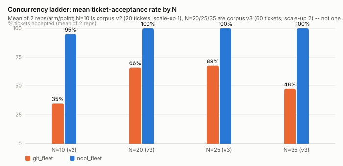

# Nool Benchmark Suite

This repository contains benchmarks comparing [Nool](https://nool.dev) with
Git. It includes deterministic mechanism tests, synthetic agent-fleet studies
and coding-agent pilots. Track C currently supports Claude Code, OpenCode and
Codex.

**Codex CLI audit (2026-11-02):** [execution results, test loopholes and Nool setup review](docs/findings/2026-11-02-codex-benchmark-audit.md).
Run the single/multi grid and behavioral fleet pilot with
`make codex-smoke MODEL=gpt-5.6-luna`. These are integration pilots, not an
enterprise qualification or a statistically adequate product comparison.

**Design spec / pre-registration:**
`docs/superpowers/specs/2026-08-20-nool-benchmark-suite-design.md` —
hypotheses H1–H7 and the analysis plan were committed before any Tier 1 data
was collected. Read it before the numbers.

**Enterprise build-versus-buy evaluation:**
[CLI-grounded coverage review and runnable profile](docs/enterprise-benchmarks.md)
adds source-size/navigation, trusted CI evidence, audit replay/tampering,
independent approval/resume and lease-pressure probes, plus a matched-run ownership
cost calculator. Start with `make -f enterprise/Makefile smoke`; the full profile
is opt-in. Synthetic probes are kept separate from agent/fleet evidence.

**Results across the suite:** [current results and limits](docs/findings/2026-11-01-benchmark-results.md)
summarizes Tracks B, C, D and G plus the November enterprise probes. It links
to the detailed reports and raw artifacts; the tracks are not combined into a
single score.

## What the results say

There is no single winner across these tests. Nool prevents some merge and
attribution failures, but its landing path takes longer than a comparable Git
hook. In fleet runs with accurate file plans, a Git scheduler matched Nool.
With deliberately noisy plans, Nool had a small lead, based on two runs per
condition. The coding-agent and enterprise probes are early pilots, not
procurement evidence.

The [results overview](docs/findings/2026-11-01-benchmark-results.md) gives
the numbers and limitations for each track. In particular, it records that
the latest enterprise smoke run passed 35 of 36 checks; the failed
imported-history check remains part of the result.

## How this study differs

Most coding-agent benchmarks compare models or tasks. This suite asks a
different question: what changes when the version-control and coordination
system changes while the task stays the same? The fleet studies also vary the
number of agents. They complement existing benchmarks; they do not replace
them.

| Benchmark | Agents | Unit under test | Concurrent writers to one repo | Independent variable | Scale |
|---|---|---|---|---|---|
| SWE-bench (+ Verified / Lite) | 1 | GitHub issue → patch | No | model/agent | 2,294 tasks, 12 Python repos |
| SlopCodeBench | 1 | agent re-extends its own prior solution across checkpoints | No | model/agent, long-horizon only | 20 problems × 93 checkpoints |
| SWE-EVO | 1 | multi-file feature evolution from real release notes | No | model/agent | 48 tasks, 7 repos, avg 21 files/task |
| CooperBench | 2 (fixed) | two features landed on one shared repo concurrently | Yes — real merge-conflict risk | task difficulty / model; coordination mechanism (git + Redis messaging) held fixed | ~600 tasks, 12 repos, 4 languages (arXiv:2601.13295) |
| **nool_benchmarks (this suite)** | N=10–50 (concurrency ladder) | ticket-level changes dispatched across a shared corpus | Yes — merge conflicts / build-poisoning / attribution ARE the metrics | **VCS/coordination substrate: git vs nool**; tasks and agent count held fixed | 60-ticket corpus v3; N=25 and N=35 measured to date, N=50 pre-registered but deprioritized in favor of the mechanism question (see below) |

CooperBench is the closest comparison because it also has concurrent writers.
It holds the coordination mechanism fixed and tests tasks with two agents;
this suite holds tasks fixed and varies the coordination mechanism and fleet
size. CooperBench, SlopCodeBench and SWE-EVO adaptations are planned, but no
results from those adaptations have been collected yet. See the
[design spec](docs/superpowers/specs/2026-08-20-nool-benchmark-suite-design.md#sec-5).

*Note on the CooperBench figure above:* the paper (arXiv:2601.13295) reports
~600 tasks across 12 repos / 4 languages; a public adapter repository for the
same benchmark lists smaller subset counts (199 features / 30 tasks / 652
feature pairs). The paper figure is cited as canonical here — confirm
directly against the benchmark's own source before the Track A1 integration
relies on either number.

## Fleet results

The fleet results are more nuanced than “Nool beats Git.” With accurate
footprints, a Git scheduler and Nool accepted all tickets in the measured
arms. When footprints were deliberately corrupted, Nool's acceptance rate
fell less in the two runs per condition. The [full report](docs/findings/2026-08-21-findings.md)
contains the counts, cost data, figures and audit of what the harness did.




This is not a final product comparison. The dispatch gate in these runs was
implemented in the harness, not enforced by Nool, and the experiment has too
few repetitions for a strong conclusion. One Git run also accepted every
ticket while leaving the final main branch unhealthy. Ticket acceptance and
repository health are separate outcomes.

Track B measures individual mechanisms rather than agent quality. Its 7.19.0
rerun preserved the Nool correctness results from 7.8.0. It also measured
landing overhead: fast Nool landings took about 6.5×, 9.8× and 39× the time of
hooked Git for 1-, 10- and 100-file changes. The [cross-track overview](docs/findings/2026-11-01-benchmark-results.md)
and [Track B report](docs/findings/2026-10-12-trackb-7.19.0-rerun.md) give the
other mechanism results and caveats.

## Layout

| Path | What |
|---|---|
| `micro/` | Track B — deterministic mechanism micro-benchmarks (no LLM, no API keys, free to run) |
| `results/micro/` | Raw JSON output of Track B, committed with full provenance |
| `harness/` | Track C — LLM-in-the-loop 2×2 experiment harness; Track D fleet runner (`fleet_run.py`) |
| `tasks/` | Track C/D task catalogs (spec + starter + hidden held-out tests; fleet ticket corpora) |
| `results/trackc/` | Raw LLM-run records: 2×2 grid (`runs.jsonl`) and fleet runs (`fleet_runs.jsonl`) |
| `results/trackc/transcripts_manifest.jsonl` | SHA-256 manifest of every raw transcript (transcripts themselves are gitignored; verify with `make check-transcripts`) |
| `results/replications/` | Per-version Track B snapshots + `MANIFEST.md` indexing every run's conditions |
| `analysis/summarize.py` | Renders all committed results as tables, incl. run-level cross-rep inference (exact permutation Mann-Whitney per corpus/N/model cell, underpowered cells labeled). Numbers only — no conclusions in code |
| `analysis/make_figures.py` | Regenerates every figure in `docs/findings/` from the raw JSON |
| `Makefile` / `Dockerfile` | One-command replication (`make trackB`, `tier1`, `trackC`) and containerized execution ([§8](docs/superpowers/specs/2026-08-20-nool-benchmark-suite-design.md#sec-8)) |
| `docs/findings/` | Findings report with figures; `docs/paper/` holds the academic write-up |
| `docs/findings/2026-11-01-benchmark-results.md` | Current cross-track results guide, with limits and links to raw evidence |

Pre-suite pilot material (manual runs, no provenance — **not evidence**) was
archived and then removed from the working tree; it remains recoverable from
Knot DAG history (the `archive/` knots of 2026-08-20, including
`ARCHIVE.md`, which inventories it and explains why each item is excluded).

## Run the mechanism benchmarks (Track B)

Requirements: macOS/Linux, Python 3.11+, git, and the `nool` CLI on PATH
(version is recorded in each result's provenance block).

```bash
cd micro
python3 b1_overhead.py      # hook latency; propose/solidify vs add/commit
python3 b2_concurrency.py   # N concurrent writers, one shared workspace
python3 b3_recovery.py      # remove a bad landing, keep later unrelated work
python3 b4_guardrails.py    # broken/test-breaking commits vs a git control arm
python3 b5_swarm_merge.py   # N-branch merge: disjoint / same-anchor / diff-functions
python3 b6_context_retrieval.py       # semantic query vs grep+read baseline
python3 b7_regression_localization.py # nool debug bisect vs git bisect
python3 b8_blast_false_positive.py     # precision and false positives on Go graphs
python3 b9_blast_multilang.py          # blast-radius checks across languages
python3 ../analysis/summarize.py
```

### B10: admission and evidence cost

B10 measures how change admission and its evidence checks scale with repository
size (R) and change surface (S, the edited symbol's reverse-call/use region
plus its attached contracts). The preregistration expected admission to stay
within 2× from R=100 to R=10,000 at a fixed S, and expected admission cost to
increase with S. The results did not support the flat-cost expectation.

```bash
make b10-freeze                  # copy the installed release to work/bin/nool (the only binary B10 runs)
make b10-sanity                  # ~2 min smoke run, R=100, output in work/b10_sanity/ (never results/)
make b10                         # b10_asymptotic, R in {100, 1000, 10000} -> results/micro/b10_assurance_scaling.json
make b10-self                    # b10_self, replays >= 30 real mutation knots -> results/micro/b10_self.json
python3 analysis/summarize.py    # prints the B10 tables; analysis/make_figures.py draws the three B10 figures
```

The synthetic run uses Go packages and four change surfaces (D=0, 4, 16 and
64 callers). It checks admission, affected-test selection and the cost of
running evidence against a Git control. The fixture calculates the expected
dependency closure and affected tests, so a mismatched answer is excluded
rather than treated as a valid measurement. The evidence run is package-wide
in Go; the large-repository evidence cells are therefore limited to one
change surface and one repetition.

`b10_self` replays at least 30 recent changes from the Nool repository against
a copy of its ledger. It records the changed region, contracts, test-selection
mode and elapsed time. It does not measure whether those changes were correct.
The planned `b10_oss` probe against a third-party Go service has not been
implemented.

The scorer treats non-zero exits as refusals and timeouts as incomplete; neither
is counted as a timing success. It checks the dependency closure before using a
cell in the scaling fit. The binary is frozen and verified before and after the
run. See `micro/validate_scorers.py` for the injected-fault checks.

The scale probe uses one synthetic Go layout. `b10_self` replays changes from
one Rust repository at one point in its history. Neither predicts absolute
latency on a buyer's codebase or tests other production repositories. Admission
does not test whether a change is correct, and the concurrency probe is limited
to N=4 on one machine. The result records machine load because timings depend
on it.

Each script builds a temporary workspace, uses a monotonic clock, and writes
JSON with tool versions, platform and timestamp to `results/micro/`. A rerun
overwrites that result file, so copy it first if you want to keep both runs.
Compare results by direction and conditions; exact milliseconds vary by host.

Details that affect how to read the results:

- Merge outcomes (B5) are detected from working-tree state (unmerged paths,
  conflict markers), never from exit codes; exit-code reliability is itself
  a recorded metric.
- B2's git arm counts a change as landed even when another writer's commit
  swept it in (`ops_swept_into_other_commit`) — attribution loss and landing
  are reported separately.
- B1's 100-file cell uses `--auto-justify` because nool's blast-radius gate
  blocks wide non-interactive proposes; the gate's existence is part of the
  result.
- B3 reports both a linear timeline and a thread-separated timeline for
  nool's `pluck` recovery path.

## Run the agent benchmark (Track C)

Track C runs the same task through Git and Nool in single-agent and multi-agent
modes. Use one pinned model for all four cells in a run. Hidden acceptance
tests are added only after the agent work is complete.

```bash
cd harness
python3 run_experiment.py --harness claude --model <pinned-model-id> \
    --tasks redux_go --cells all --reps 5
```

Adapters record metrics reported by each CLI, including tokens, turns and tool
calls when available. Missing fields remain null; the harness does not infer
them. Claude Code, OpenCode and Codex adapters are implemented. See
`harness/README.md` for isolation requirements and adapter details.

## Frozen cross-repository protocol (v4)

Future comparative fleet evidence is governed by
`protocols/fleet_v4.json`, pinned by `protocols/fleet_v4.sha256`. Its primary
unit is the run, its minimum target is 10 repetitions per arm/cell, and its
primary comparisons put native nool coordination against `git_competitive`:
declared-footprint scheduling under recorded noise, a build/test/secret-gated merge queue, and
one rebase-or-agent-rerun conflict recovery pass.

The fleet runner is now language-neutral. A task root supplies a pinned
starter, ticket/footprint metadata, held-out acceptance assets, and argument-
array build/test/accept commands; see `tasks/CORPUS_CONTRACT.md`. Every new
record carries repository, language, source kind, command contract, and the
frozen protocol hash. Analysis strata include repository, language, model,
harness, worker count, tier, and footprint noise, and never use tickets as
independent replicates.

```bash
make validate-study     # protocol pin, corpus contracts, unit tests
make validate-harness   # every arm once, deterministic scripted adapter, $0
python3 harness/fleet_run.py --harness claude --model <pinned-model-id> \
    --task-root tasks/fleet_service --tickets tickets_v3.json \
    --arms git_competitive,nool_gated --workers 10 --reps 10
```

This implements the comparative framework; it does not manufacture external
validity. The repository currently contains only the synthetic Go corpus.
Imported CooperBench-style tasks and additional real TypeScript, Python, and
Java/Rust repositories must retain their upstream prompts and acceptance
criteria and must be committed before multilingual or independent-replication
claims are made.

## Current status

Track B has been run on seven Nool versions, through 7.19.0. Track C has a
three-run Claude grid and a one-repetition Codex pilot. Track D has results
through N=35; N=50 remains unrun. The footprint-noise comparison has two
repetitions per condition, below the protocol's ten-run target. External
benchmark adaptations have not been run.

The [results overview](docs/findings/2026-11-01-benchmark-results.md) links to
the run-level reports and explains the limits of each result. The protocol
and preregistration remain in `protocols/fleet_v4.json` and
`docs/superpowers/specs/2026-08-20-nool-benchmark-suite-design.md`.

## Limitations and corrections

The context-retrieval test initially missed a file-level query on Nool 7.1.4.
The same query worked on 7.8.0 and 7.19.0: the latter returned the expected
file in 497 bytes, while the grep-and-read control used 660. The symbol query
also returned the expected result; a nonexistent symbol remained unresolved.

The fleet results assume each agent has a distinct Nool identity. If several
local agents inherit the operator's identity, conflict checks can miss a live
lease and two exclusive leases can be granted for the same path. The current
study does not include a shared-identity arm. Until that is tested, interpret
the noisy-footprint result as conditional on correct identity setup. The
[fleet report](docs/findings/2026-08-21-findings.md) and
[paper](docs/paper/2026-08-nool-fleet-study.md#sec-5-6) discuss attribution and
baseline limits in more detail.

This is a vendor-run study. The hypotheses and analysis plan were preregistered
and their hash is recorded, but the preregistration was not externally
timestamped. Many agent and fleet cells are below the target sample size; the
analysis labels them underpowered. The collected runs were local rather than
containerized. They use a synthetic Go corpus, so independent replications and
buyer repositories are still needed. The full list of limits is in the
[design spec](docs/superpowers/specs/2026-08-20-nool-benchmark-suite-design.md#sec-7).

One audit also found that an earlier harness version exposed CI, CODEOWNERS and
policy documents to the Nool worktrees but not to Git worktrees. Protocol v4
copies the shared governance contract into both arms before they diverge.
Historical results retain their original provenance and should not be described
as having equal policy visibility. See the [audit note](docs/paper/2026-08-nool-fleet-study.md#sec-5-6).

## License

Apache-2.0 — see `LICENSE` and `NOTICE`. You may use, modify, and
redistribute freely; redistributions must retain the attribution notices
(Nool, Inc.) per the license terms.
